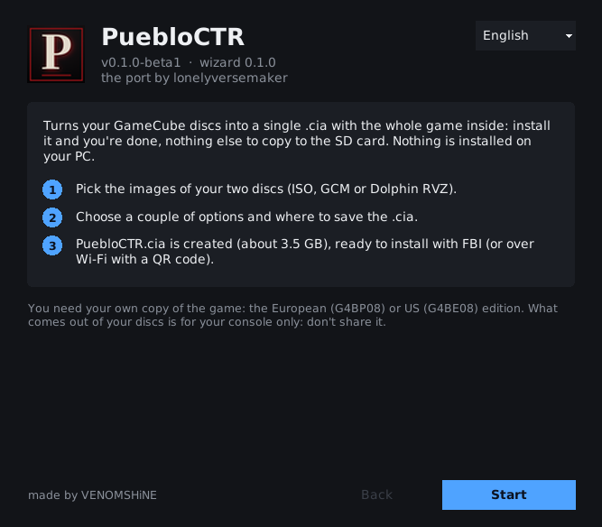

# PuebloCTR Compiler

**Tus discos de Resident Evil 4 (GameCube) → un solo `.cia` para tu New 3DS.** Eliges las imágenes de tus dos discos, pulsas un botón y sale `PuebloCTR.cia` con todo el juego dentro. Lo instalas con FBI y a jugar, sin copiar carpetas a la SD.

[PuebloCTR](https://github.com/lonelyversemaker/PuebloCTR) es el port de Resident Evil 4 de GameCube a la New 3DS, de lonelyversemaker. Este compilador lo prepara todo en un solo archivo. Es solo para ese juego: con otros juegos no está probado.

*English below · [Read in English](#english)*

<a href='https://ko-fi.com/W3A028X2KV' target='_blank'></a>

<p align="center">
  
  
</p>

## Descargar

De la [última versión](https://github.com/venomshine/PuebloCTRCompiler/releases/latest):

- **Windows:** `PuebloCTR.exe`. Ábrelo y listo.
- **Linux:** `PuebloCTR-Linux.tar.gz`. Descomprímelo y ábrelo desde la terminal:
  ```
  tar xzf PuebloCTR-Linux.tar.gz
  ./PuebloCTR/PuebloCTR
  ```

No instala nada ni pide Python: lleva dentro todo lo que necesita.

**Necesitas:**
- **Tus propios discos** de Resident Evil 4 para GameCube, edición europea (G4BP08) o americana (G4BE08), como imágenes ISO, GCM o RVZ de Dolphin.
- **Windows 10/11** de 64 bits, o **Linux** de 64 bits (probado en Debian 12 y Fedora 40).
- Unos **7 GB libres** en el disco del PC mientras se crea el `.cia`. Al final solo queda el `.cia`, de unos 3,5 GB.
- Una **New 3DS, New 3DS XL o New 2DS XL** con homebrew y FBI (por ejemplo, con [3ds.hacks.guide](https://3ds.hacks.guide/)). Las 3DS y 2DS antiguas no pueden con el juego.

## Cómo se usa

1. Abre el programa. Arriba a la derecha puedes cambiar el idioma (español o inglés). Pulsa **Empezar**.
2. **Tus discos:** elige la imagen del disco 1 y la del disco 2. Te dice al momento si son las correctas.
3. **Opciones:** pack de texturas, vídeos, tus partidas de GameCube si quieres traerlas, y dónde guardar el `.cia`. Los vídeos necesitan ffmpeg: si no lo tienes, el botón **Descargar** lo baja.
4. Pulsa **Crear el .cia** y espera unos minutos.
5. Instálalo en la consola:
   - **Con la SD:** copia `PuebloCTR.cia` a la SD y en la consola abre FBI → SD → `PuebloCTR.cia` → *Install CIA*.
   - **Por Wi-Fi:** pulsa **Instalar por Wi-Fi (QR)** y en la consola abre FBI → *Remote Install* → *Scan QR Code*. No hay que copiar nada, pero son 3,5 GB y tarda más.

Hacen falta unos 3,5 GB libres en la SD. Cuando esté instalado, puedes borrar el `.cia`.

## Funciones

- **Un solo archivo:** el juego, el pack de texturas y los vídeos van dentro del `.cia`. En la SD solo se guardan tus partidas y tus ajustes (en `sd:/3ds/pueblo/`).
- **Comprueba tus discos** antes de empezar: si es la edición correcta, si falta uno o están cambiados, y si el formato no sirve (te dice cómo convertirlo con Dolphin).
- **Tus partidas de GameCube** (`.gci` / `.gcs`) van dentro del `.cia` y pasan a la SD la primera vez que abres el juego. Si ya tienes partidas en la consola, no se tocan.
- **ffmpeg con un botón:** lo busca en tu PC y, si no lo tienes, lo descarga.
- **Progreso claro:** porcentaje, tiempo que queda y en qué paso va.
- **Al terminar:** el archivo, su tamaño y su md5, y un QR para instalarlo por Wi-Fi con FBI.
- **Español e inglés:** la primera vez se abre en el idioma de tu PC y luego recuerda el que elijas.
- **Windows y Linux**, con las mismas pantallas.
- En el menú HOME, el icono dice **PuebloCTR · Compiled by VENOMSHiNE**.

## Qué cambia respecto a PuebloCTR

Con PuebloCTR tal cual, hay que copiar a la SD una carpeta de unos 3,5 GB que hace PuebloPrep e instalar su `.cia` aparte. Aquí va todo en el `.cia`. Por lo demás, es el mismo juego: PuebloCTR v0.1.0-beta1, con sus ajustes y sus controles.

## Antes de actualizar

Cada versión de PuebloCTR necesita su propio `PuebloCTR.exe`, porque el motor y el pack de texturas tienen que ser de la misma versión. Tus partidas no se tocan al reinstalar (están en `sd:/3ds/pueblo/saves/`), pero cópialas a otro sitio de vez en cuando.

## Errores y sugerencias

¿Algo falla o se ve raro? Abre un [issue](https://github.com/venomshine/PuebloCTRCompiler/issues) o escríbeme en [Discord](https://discord.com/invite/yVKp8JwV4e). Ayuda mucho el registro del programa (botón **Ver el registro** al terminar) y, si el juego se cierra en la consola, el archivo `sd:/3ds/pueblo/crash.txt`. Si quieres apoyar el proyecto, invítame a un café:

<a href='https://ko-fi.com/W3A028X2KV' target='_blank'></a>

## Compilar desde el código

Todo se compila en Linux con Docker, sin Windows:

```
tools/make_runtime.sh      # el motor de PuebloCTR con patches/unico-cia.patch y PuebloPrep -> tools/runtime/
tools/build_exe.sh         # Windows: out/PuebloCTR.exe (PyInstaller dentro de Wine)
tools/build_linux.sh       # Linux: out/PuebloCTR-Linux.tar.gz (en Ubuntu 22.04)
```

`make_runtime.sh` necesita además cmake, ninja y `g++-mingw-w64-x86-64-posix`. La versión de PuebloCTR va en `PUEBLO_REF` (`tools/make_runtime.sh`) y en `PUEBLO_VERSION` (`tools/pueblo3ds/__init__.py`).

Cómo funciona por dentro:

- **El motor** es PuebloCTR con `patches/unico-cia.patch`: si el `.cia` lleva el juego dentro, lee los discos, las texturas y los vídeos de su romfs; si no, de `sd:/3ds/pueblo/` como siempre. Las partidas, los ajustes y `crash.txt` siguen en la SD, porque el romfs es de solo lectura.
- **El `.cia`:** makerom hace uno pequeño con el motor, el icono y el banner, y `ciabuild.py` le mete el juego por partes, sin cargarlo en la memoria (makerom pedía tanta RAM como el juego). El romfs sale idéntico al de makerom, y `tests/verificar_cia.py` comprueba todos sus hashes.

```
tools/
  PuebloCTR.pyw          entrada del programa (ventana, o sin ventana con argumentos)
  pueblo3ds/gui.py       las pantallas (Tk)
  pueblo3ds/build.py     PuebloPrep, partidas, ffmpeg y el .cia final
  pueblo3ds/ciabuild.py  el romfs y el .cia por partes
  pueblo3ds/discs.py     reconoce las imágenes ISO / GCM / RVZ
  pueblo3ds/serve.py     el servidor para instalar con FBI por QR
  pueblo3ds/i18n.py      los idiomas: la clave es el texto en español
  i18n_check.py          avisa de los textos sin traducir
patches/unico-cia.patch  el motor que lee el juego desde el .cia
tests/verificar_cia.py   comprueba un .cia (hashes, y archivos contra una carpeta)
```

Para añadir o corregir traducciones, edita `tools/pueblo3ds/i18n.py` y ejecuta `python3 tools/i18n_check.py`.

Sin ventana (para pruebas): `PuebloCTR.exe build disco1.rvz disco2.rvz -o PuebloCTR.cia [--sin-texturas] [--sin-videos] [--partida F.gci]`. La salida va a `PuebloCTR.log`, junto al programa.

---

## English

**Your Resident Evil 4 (GameCube) discs → one `.cia` for your New 3DS.** Pick the images of your two discs, press a button, and you get `PuebloCTR.cia` with the whole game inside. Install it with FBI and play, with no folders to copy to the SD card.

[PuebloCTR](https://github.com/lonelyversemaker/PuebloCTR) is lonelyversemaker's port of Resident Evil 4 for GameCube to the New 3DS. This compiler puts it all in a single file. It's for that game only: other games are untested.

**Download** from the [latest release](https://github.com/venomshine/PuebloCTRCompiler/releases/latest): `PuebloCTR.exe` for Windows, or `PuebloCTR-Linux.tar.gz` for Linux (unpack it and run `./PuebloCTR/PuebloCTR` from a terminal). It installs nothing and needs no Python.

**You need:** your own Resident Evil 4 GameCube discs, European (G4BP08) or US (G4BE08) edition, as ISO, GCM or Dolphin RVZ images; Windows 10/11 64-bit or 64-bit Linux (tested on Debian 12 and Fedora 40); about 7 GB free on your PC while the `.cia` is made; and a New 3DS, New 3DS XL or New 2DS XL with homebrew and FBI.

**How to use it:** open the program (the language selector is at the top right: English or Spanish), pick your two disc images, choose your options (texture pack, movies, your GameCube saves, where to save the `.cia`) and press **Create the .cia**. Then copy it to the SD card and install it with FBI, or install it over Wi-Fi with the QR code (FBI → *Remote Install* → *Scan QR Code*). You need about 3.5 GB free on the SD card. Your saves and settings stay in `sd:/3ds/pueblo/`, and your GameCube saves come along inside the `.cia` if you add them.

**Updating:** each PuebloCTR version needs its own `PuebloCTR.exe`. Your saves aren't touched when you reinstall.

**Build:** `tools/make_runtime.sh`, then `tools/build_exe.sh` (Windows) and `tools/build_linux.sh` (Linux), all with Docker.

Bugs and ideas: [issues](https://github.com/venomshine/PuebloCTRCompiler/issues) or [Discord](https://discord.com/invite/yVKp8JwV4e).

---

Hecho por **VENOMSHiNE** · [GitHub](https://github.com/venomshine) · [Discord](https://discord.com/invite/yVKp8JwV4e) · [Ko-fi](https://ko-fi.com/venomshine)

PuebloCTR es el port de [lonelyversemaker](https://github.com/lonelyversemaker/PuebloCTR); yo solo lo compilo en un `.cia`. PuebloCTR Compiler es un proyecto no oficial y no está afiliado a Nintendo, Capcom ni CRI Middleware. No incluye ningún dato del juego: necesitas tus propios discos. *PuebloCTR Compiler is an unofficial project, not affiliated with Nintendo, Capcom or CRI Middleware. No game data is included.*

## Licencia

PuebloCTR Compiler es software libre bajo la **[GNU GPL v3](LICENSE)** con términos adicionales de atribución ([NOTICE.md](NOTICE.md)):

- Puedes usar, estudiar y modificar el código, pero lo que hagas con él también debe ser de código abierto bajo la GPL-3.0.
- **Debes dar crédito visible** en tu README y en la pantalla de créditos o «Acerca de» de tu app:
  > Basado en PuebloCTR Compiler de VENOMSHiNE — https://github.com/venomshine/PuebloCTRCompiler
- No puedes presentarlo como tuyo, y las versiones modificadas deben indicar que lo son.

*License: GNU GPL v3 with additional attribution terms — see [NOTICE.md](NOTICE.md).*

Incluye PuebloCTR y PuebloPrep (MIT), makerom (MIT) y QR Code generator de Project Nayuki (MIT), que conservan sus licencias: la lista completa está en [NOTICE.md](NOTICE.md).
