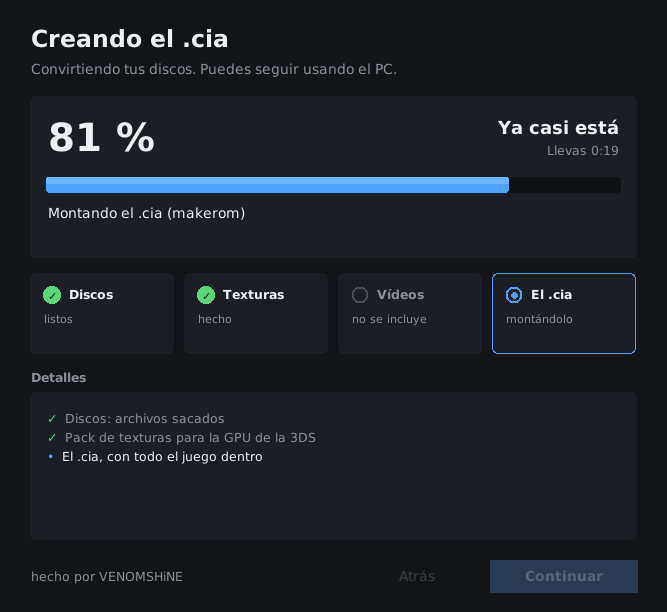

# PuebloCTR Compiler

**Tus discos de GameCube → un solo `.cia` para tu New 3DS.** El asistente de Windows para [PuebloCTR](https://github.com/lonelyversemaker/PuebloCTR): eliges tus dos discos, pulsas un botón y sale `PuebloCTR.cia` con todo el juego dentro. Lo instalas con FBI y listo, sin copiar carpetas a la SD.

*English below · [Read in English](#english)*

<a href='https://ko-fi.com/W3A028X2KV' target='_blank'></a>

<p align="center">
  
  
</p>

## Descargar

Descarga `PuebloCTR.exe` de la [última versión](https://github.com/venomshine/PuebloCTRCompiler/releases/latest). Es portátil: no instala nada ni pide Python. Lleva dentro el motor de PuebloCTR ya compilado, PuebloPrep y makerom.

Necesitas:
- **Tu propia copia del juego:** los dos discos de la edición europea (G4BP08) o americana (G4BE08), como imágenes ISO, GCM o RVZ de Dolphin.
- **Windows 10/11** de 64 bits, con unos **7 GB libres** en el disco donde guardes el `.cia` mientras se crea (al final queda solo el `.cia`, de unos 3,5 GB).
- Una **New 3DS, New 3DS XL o New 2DS XL** con homebrew y FBI (por ejemplo, con [3ds.hacks.guide](https://3ds.hacks.guide/)). Las 3DS y 2DS antiguas no pueden con el juego.

## Cómo se usa

1. Abre `PuebloCTR.exe` → **Empezar**.
2. **Tus discos:** elige la imagen del disco 1 y la del disco 2. Te dice al momento qué edición es y si falta algo.
3. **Opciones:** pack de texturas, vídeos (necesitan ffmpeg: si no lo tienes, el botón **Descargar** lo baja), tus partidas `.gci` / `.gcs` si quieres traerlas, y dónde guardar el `.cia`. Si tienes la SD de la consola conectada, **Guardarlo en la SD** lo deja directamente en `SD:\cia\`.
4. **Crear el .cia** y espera (unos minutos; los vídeos son lo que más tarda).
5. Instálalo:
   - **Por Wi-Fi:** pulsa **Instalar por Wi-Fi (QR)** y en la consola abre FBI → *Remote Install* → *Scan QR Code*. No hay que copiar nada, pero son 3,5 GB y tarda.
   - **Con la SD:** copia `PuebloCTR.cia` a la SD (por ejemplo a `cia`) y en la consola: FBI → SD → cia → `PuebloCTR.cia` → *Install CIA*.

Hacen falta unos 3,5 GB libres en la SD para instalarlo. Después puedes borrar el `.cia`.

## Funciones

- **Un solo archivo:** el juego (discos, texturas y vídeos) va dentro del `.cia`. En la SD solo se guardan tus partidas, los ajustes y los informes de errores, en `sd:/3ds/pueblo/`, como en PuebloCTR.
- **Reconoce tus imágenes** antes de empezar: edición, número de disco, discos cambiados o de ediciones distintas, imágenes recortadas y formatos que no sirven (CISO, GCZ, WIA: te dice cómo convertirlos con Dolphin).
- **Tus partidas de GameCube** (`.gci` / `.gcs` de Dolphin o de una tarjeta) van dentro del `.cia` y pasan a la SD al arrancar la primera vez, solo si allí no hay ya una tarjeta de memoria. Tus partidas nunca se pisan.
- **ffmpeg sin complicaciones:** lo busca junto al `.exe`, en `C:\ffmpeg\bin` y en el PATH, comprueba que tenga libx264, y si no, lo descarga con un botón.
- **Rápido y ligero:** el `.cia` se escribe por partes, sin cargar el juego en la memoria. 3,5 GB en unos segundos y con unos 100 MB de RAM (makerom necesitaba 3,5 GB de RAM y minuto y medio).
- **Progreso claro:** porcentaje, tiempo que queda (más exacto a partir de la segunda vez), cada fase y lo que está haciendo.
- **Al terminar:** el archivo, su tamaño y su md5, e instalación por Wi-Fi con un QR para FBI.
- **Sin ventana**, para pruebas: `PuebloCTR.exe build disco1.rvz disco2.rvz -o PuebloCTR.cia [--sin-texturas] [--sin-videos] [--partida F.gci]` (la salida va a `PuebloCTR.log`).

## Qué cambia respecto a PuebloCTR

PuebloCTR lee el juego de la carpeta `sd:/3ds/pueblo/` que hace PuebloPrep, y su `.cia` va aparte. Aquí el motor lleva `patches/unico-cia.patch`:

- Al arrancar, si el `.cia` lleva el juego dentro, lee los discos, el pack de texturas y los vídeos de su romfs. Si no, de la SD, como siempre.
- Lo que se escribe sigue en la SD, porque el romfs es de solo lectura: `saves/memcard.bin`, `settings.bin`, `pueblo.cfg` y `crash.txt`.
- No cambia nada más del juego: misma versión de PuebloCTR (v0.1.0-beta1), mismos ajustes, mismos controles.

## Errores conocidos

- **Sin probar todavía en una consola.** En el PC está comprobado que el `.cia` sale bien formado: todos sus hashes, y cada archivo del juego encontrado y leído como lo hace la consola. Falta comprobar en una New 3DS que el juego carga igual de fluido leyendo del `.cia` que de la SD (sobre todo las texturas y al cambiar de zona).
- Los vídeos todavía no se han probado con discos reales.
- Cuando salga una versión nueva de PuebloCTR, hay que hacer un `PuebloCTR.exe` nuevo: el motor y el pack de texturas tienen que ser de la misma versión.

## Errores y sugerencias

¿Algo falla o se ve raro? Abre un [issue](https://github.com/venomshine/PuebloCTRCompiler/issues) o escríbeme en [Discord](https://discord.com/invite/yVKp8JwV4e). El registro de PuebloPrep (botón **Ver el registro**, o `%LOCALAPPDATA%\PuebloCTR\puebloprep.log`) ayuda mucho; si el juego se cierra en la consola, también `sd:/3ds/pueblo/crash.txt`. Si quieres apoyar el proyecto, invítame a un café:

<a href='https://ko-fi.com/W3A028X2KV' target='_blank'></a>

## Compilar desde el código

Todo se compila en Linux con Docker, sin Windows:

```
tools/make_runtime.sh      # PuebloCTR + patches/unico-cia.patch (en su imagen Docker) y puebloprep-cli.exe -> tools/runtime/
tools/build_exe.sh         # PyInstaller dentro de Wine (Docker) -> out/PuebloCTR.exe
```

`make_runtime.sh` necesita además cmake, ninja y `g++-mingw-w64-x86-64-posix` para PuebloPrep. La versión de PuebloCTR va en `PUEBLO_REF` (`tools/make_runtime.sh`) y en `PUEBLO_VERSION` (`tools/pueblo3ds/__init__.py`).

```
tools/
  PuebloCTR.pyw        entrada del .exe (asistente, o modo sin ventana con argumentos)
  pueblo3ds/gui.py     el asistente (Tk): bienvenida, discos, opciones, progreso, listo, QR
  pueblo3ds/build.py   PuebloPrep, partidas, ffmpeg, espacio libre y el .cia final
  pueblo3ds/ciabuild.py  romfs (IVFC) y .cia por partes, igual byte a byte que makerom
  pueblo3ds/discs.py   reconoce imágenes ISO / GCM / RVZ
  pueblo3ds/serve.py   servidor para instalar con FBI por QR
patches/unico-cia.patch  el motor que lee el juego del romfs del .cia
tests/verificar_cia.py   comprueba un .cia (hashes, y archivos contra una carpeta)
```

Desde el código, sin hacer el `.exe`: `python3 tools/run.py build disco1.iso disco2.iso -o PuebloCTR.cia` (con `tools/runtime/` hecho).

---

## English

**Your GameCube discs → one `.cia` for your New 3DS.** A Windows wizard for [PuebloCTR](https://github.com/lonelyversemaker/PuebloCTR): pick your two discs, press a button, and you get `PuebloCTR.cia` with the whole game inside. Install it with FBI and you're done. There's no folder to copy to the SD card.

**Download:** `PuebloCTR.exe` from the [latest release](https://github.com/venomshine/PuebloCTRCompiler/releases/latest). It's portable: it installs nothing and needs no Python, and it carries PuebloCTR's engine, PuebloPrep and makerom.

**You need:**
- Your own copy of the game: both discs of the European (G4BP08) or US (G4BE08) edition, as ISO, GCM or Dolphin RVZ images.
- Windows 10/11, 64-bit, with ~7 GB free on the drive where the `.cia` is saved while it's made.
- A New 3DS / New 3DS XL / New 2DS XL with homebrew and FBI.

**Use:** open the program, pick your disc images and choose your options: texture pack, movies (ffmpeg is found or downloaded with one button), your `.gci` / `.gcs` saves and where to save the `.cia`. Then press **Crear el .cia**. Install it over Wi-Fi with the QR code (FBI → *Remote Install* → *Scan QR Code*), or copy it to the SD card and install it with FBI. You need ~3.5 GB free on the SD card.

**What's different from PuebloCTR:** the engine is built with `patches/unico-cia.patch`. It reads the discs, textures and movies from the `.cia`'s own romfs; saves, settings and crash reports stay on the SD card in `sd:/3ds/pueblo/`. Imported saves are copied there on first start, only if no memory card exists yet. The `.cia` is written piece by piece: 3.5 GB in seconds with ~100 MB of RAM, byte-identical to makerom's romfs.

**Known issues:** not tested on a console yet. On the PC every hash and every game file in the `.cia` checks out, but loading speed from the `.cia` versus the SD card still has to be confirmed on a New 3DS. Movies haven't been tested with real discs yet.

**Build:** `tools/make_runtime.sh` then `tools/build_exe.sh` (Linux with Docker).

Bugs and ideas: [issues](https://github.com/venomshine/PuebloCTRCompiler/issues) or [Discord](https://discord.com/invite/yVKp8JwV4e).

---

Hecho por **VENOMSHiNE** · [GitHub](https://github.com/venomshine) · [Discord](https://discord.com/invite/yVKp8JwV4e) · [Ko-fi](https://ko-fi.com/venomshine)

PuebloCTR es el port de [lonelyversemaker](https://github.com/lonelyversemaker/PuebloCTR); este asistente lo empaqueta en un solo `.cia`. PuebloCTR Compiler es un proyecto no oficial y no está afiliado a Nintendo, Capcom ni CRI Middleware. No incluye ningún dato del juego: necesitas tus propios discos. *PuebloCTR Compiler is an unofficial project, not affiliated with Nintendo, Capcom or CRI Middleware. No game data is included.*

## Licencia

PuebloCTR Compiler es software libre bajo la **[GNU GPL v3](LICENSE)** con términos adicionales de atribución ([NOTICE.md](NOTICE.md)):

- Puedes usar, estudiar y modificar el código, pero lo que hagas con él también debe ser de código abierto bajo la GPL-3.0.
- **Debes dar crédito visible** en tu README y en la pantalla de créditos o «Acerca de» de tu app:
  > Basado en PuebloCTR Compiler de VENOMSHiNE — https://github.com/venomshine/PuebloCTRCompiler
- No puedes presentarlo como tuyo, y las versiones modificadas deben indicar que lo son.

*License: GNU GPL v3 with additional attribution terms — see [NOTICE.md](NOTICE.md).*

Incluye PuebloCTR y PuebloPrep (MIT), makerom (MIT) y QR Code generator de Project Nayuki (MIT), que conservan sus licencias: la lista completa está en [NOTICE.md](NOTICE.md).
